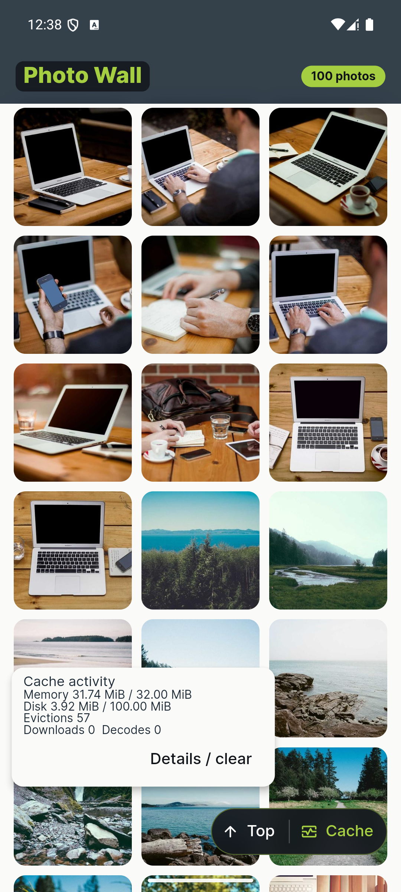
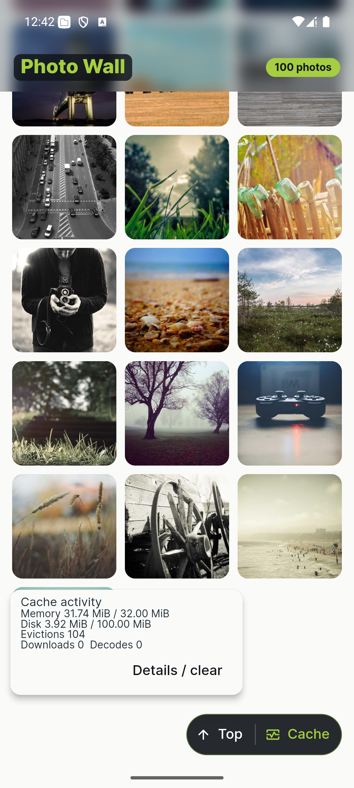

# Photo Wall

Photo Wall is a Flutter gallery of 100 remote Picsum photos. It demonstrates a
bounded decoded-image cache, a persistent disk cache, controlled image loading,
and memory-aware image ownership. The required submission target is Android.

## 1. Run the app

The project has been built in CI with Flutter 3.29.2 and Dart 3.7.2. Install
Flutter, Android Studio, and an Android SDK, then start an emulator or connect an
Android device. From the repository root:

```sh
flutter pub get
flutter devices
flutter run -d <android-device-id>
```

To run checks locally:

```sh
dart format --output=none --set-exit-if-changed lib test
flutter analyze
flutter test
flutter build apk --release
```

The APK is written to `build/app/outputs/flutter-apk/app-release.apk`. The
[v1.0.0 GitHub Release](https://github.com/Agamjot27/Photo-Wall/releases/tag/v1.0.0)
contains the downloadable Android APK. The [Android workflow](.github/workflows/android-apk.yml)
also uploads a temporary artifact when GitHub Actions is available.

The optional iOS host can be built on macOS with Xcode. A physical iPhone needs
development signing. The unsigned simulator build produced by CI cannot be
installed directly on an iPhone from Windows.

## 2. Architecture and project structure

| Area | Responsibility |
| --- | --- |
| `lib/features/photos/` | Three-column lazy gallery, viewer, live cache panel, detailed diagnostics, loading and retry states. |
| `lib/core/images/decoded_image_loader.dart` | Memory-first loading, shared requests, source recovery, decode ownership, and cancellation. |
| `lib/core/images/memory_image_cache.dart` | Custom decoded-image LRU and byte budget. |
| `lib/core/images/disk_image_cache.dart` | Persistent compressed files, index recovery, and disk LRU. |
| `lib/core/images/image_bytes_repository.dart` | Disk-before-network lookup, bounded HTTP responses, and a reusable HTTP client. |
| `lib/core/images/load_scheduler.dart` | Three permits across disk, network, and decode stages. |
| `android/` and `ios/` | Optional native thumbnail downsampling; Android also reports system memory information. |

The catalog is a checked-in snapshot of 100 distinct Picsum IDs, so startup does
not require a catalog API call. Grid URLs request a 400 px square crop. Viewer
URLs preserve aspect ratio and cap the longest side at 1600 px. Tapping a tile
opens the full-screen viewer; Back returns to the same grid scroll position.

The activity button in the gallery header toggles a small **live cache panel over
the grid**. It shows memory and disk usage in MiB, memory evictions, and ongoing
downloads and decodes while the gallery scrolls. Its **Details / clear** button
opens the full diagnostics screen, including manual cache clearing and Android
memory information.

## 3. Memory cache and eviction

Grid thumbnails use a custom `LinkedHashMap` LRU cache capped at 32 MiB of
decoded pixels. Each entry is charged `width * height * 4` bytes. A hit moves the
entry to the most-recent position. Admission evicts the oldest entries until the
new image fits; an oversized image is displayed without being cached.

The cache owns one `ui.Image` handle per entry. A widget receives a clone and
disposes its handle after it stops rendering. Eviction therefore cannot dispose
an image that is still visible. Full-screen decodes are not admitted to the
shared thumbnail cache and are released when the viewer closes. The 32 MiB
budget covers cache-owned images, not visible clones or temporary decode buffers.

## 4. Disk cache and eviction

Compressed responses are stored in the app's temporary cache directory under
SHA-256 URL keys. The disk payload budget is 100 MiB. An index records file
lengths and access times; the oldest files are removed when a write exceeds the
budget. Writes use a `.part` file followed by a rename, and the index has a
backup. Startup reconciles missing files, partial files, orphans, and stale
metadata.

Thumbnail priority is **decoded memory → disk → network**. A valid disk hit
does not download again. If a disk image cannot be decoded, its entry is
invalidated and the network is tried once. Read access times update in memory;
index writes are limited to roughly once every two seconds and flushed when
the app backgrounds. Writes, evictions, and manual clearing persist immediately.
The OS may remove app cache files, so offline access is best effort.

## 5. Memory pressure and viewer lifetime

A lifecycle-owned `WidgetsBindingObserver` trims the decoded cache when Flutter
reports memory pressure. An admission epoch prevents loads started before that
signal from immediately refilling it. Visible clone handles remain valid. The
viewer owns its full-screen image and releases it on route disposal; repeated
open/back tests check that old viewer handles are disposed.

The Android `getMemoryInfo` result is displayed in detailed diagnostics. It is
not used as a polling-based trim trigger: system-wide available memory is not an
app-specific allocation limit. Flutter's memory-pressure signal and the hard
32 MiB cache budget drive trimming.

## 6. Native platform integration

The optional MethodChannel is `com.assignment.photowall/image`.
`decodeDownsampled` accepts a local path or compressed bytes, maximum dimensions,
and PNG/JPEG output format; it returns dimensions and compressed bytes. Android
uses `BitmapFactory` on a three-thread executor. iOS uses ImageIO on a background
queue. Grid thumbnails call it after disk/network resolution, then Flutter
decodes the returned bytes for display. The full-screen viewer uses Flutter's
decoder directly.

If the native channel fails, Flutter decodes the original compressed bytes.
A channel failure therefore does not invalidate a valid disk file. When a
thumbnail is no longer needed, the loader cancels active HTTP work and tells the
native worker to skip remaining stages. A codec call already underway may still
finish; its result is discarded. Android's `getMemoryInfo` reports approximate
available, total, threshold, and low-memory values for the detailed panel.

## 7. Tradeoffs and limitations

- One scheduler limits the complete image pipeline to three active jobs. Viewer
  requests have queue priority; newer queued grid requests run before older
  ones, while jobs already running are not preempted.
- A shared `HttpClient` can reuse keep-alive connections. Each response is capped
  at 20 MiB and buffered before decode and disk write. This avoids a second
  file read but temporarily uses memory outside the decoded cache budget.
- Native downsampling satisfies the optional channel exercise, but a 400 px
  source is already small. Re-encoding and the second Flutter decode add CPU and
  copies; no performance gain is claimed without device measurements.
- Forui supplies themes and header controls; the grid, caches, scheduler, and
  image pipeline remain project code.
- The Android release APK uses debug signing for this assignment. An install with a
  different signing key cannot replace it without uninstalling the old build,
  which clears that app's local cache and data.
- Android uses Skia because Flutter 3.29.2's Impeller GLES renderer aborted on
  the API 35 emulator after fast scrolling and opening photos. The log reported
  an ungenerated texture mipmap followed by a fatal GLES render-pass check,
  matching a [reported Flutter engine issue](https://github.com/flutter/flutter/issues/168682).
  This is an engine-level failure signature, but the log alone cannot prove that
  application code played no part. The cache returns cloned `ui.Image` handles
  to widgets; evictions dispose only the cache handle, and widgets release their
  handles after the frame when scrolled away or popped. Tests cover active
  clones during eviction and viewer disposal. Disabling Impeller is a renderer
  workaround, not a fix for the underlying engine issue.

## 8. Validation and remaining limitations

The required Android features are implemented. Automated tests cover cache
budgets and eviction, restart and corrupt-file recovery, concurrency, native
fallback, stale results, navigation, memory pressure, and the live panel.
Formatting, analysis, and 46 Flutter tests passed locally on 6 November 2026.

The [v1.0.0 APK](https://github.com/Agamjot27/Photo-Wall/releases/download/v1.0.0/app-release.apk)
was built locally from commit `32178d9` with Flutter 3.29.2. GitHub reports its
SHA-256 as `84c0d700f40e2067c0d24e97cce46d65b46b1a863e7490fad288c7cc9c640a0d`,
matching the local file. It installed and launched on an API 35 emulator;
scrolling to the final photo and opening it worked. An earlier build exposed an
Impeller GLES crash on that emulator, so this release disables Impeller on
Android. The [Phase 10 Android and iOS simulator builds](https://github.com/Agamjot27/Photo-Wall/actions)
passed on an earlier revision. The workflow also has a current-stable
compatibility job, but no CI job ran for the final source because GitHub locked
the account over a billing issue. Compatibility with newer Flutter stable is
therefore unverified; the final Android APK was built with Flutter 3.29.2.
Physical-device profiling and an iOS runtime test have not been performed.

The live panel was captured on the API 35 emulator before and after scrolling.
Memory stayed below 32 MiB while the eviction count rose from 57 to 104:




See the [product requirements](docs/PRD.md), [technical design](docs/TRD.md),
[phase history](docs/implementation-plan.md), and [release checklist](docs/release-checklist.md)
for supporting decisions and verification steps.
